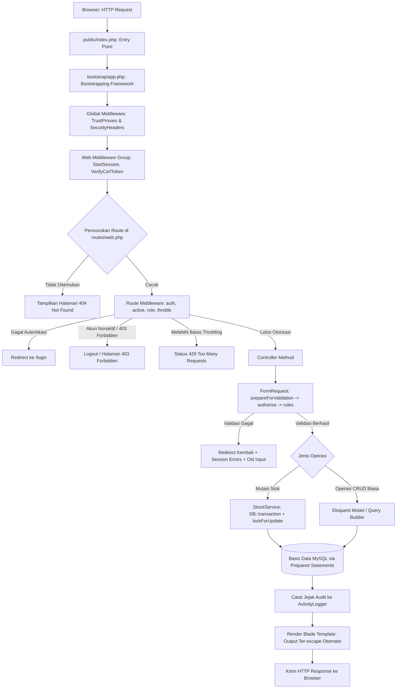
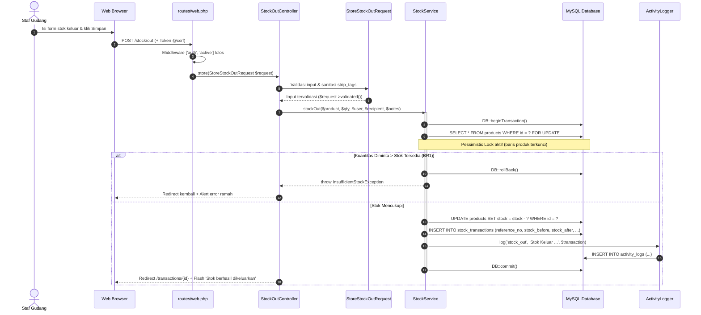
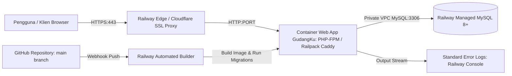

# Arsitektur Aplikasi - GudangKu

Dokumentasi arsitektur perangkat lunak, siklus hidup request (*request lifecycle*), struktur folder, pola desain (*design patterns*), serta tabel routing aplikasi **GudangKu** (Sistem Manajemen Inventaris Gudang).

---

## 1. Pola Arsitektur Perangkat Lunak

Aplikasi **GudangKu** dibangun menggunakan pola **Model-View-Controller (MVC)** klasik Laravel 12 yang diperkuat dengan 4 lapisan penunjang (*supporting layers*) untuk memastikan prinsip *Separation of Concerns* (SoC), kode yang mudah diuji (*testable*), serta *controller* yang ramping (*skinny controller*):

```
+-----------------------------------------------------------------------------------+
|                                  USER BROWSER                                     |
+-----------------------------------------------------------------------------------+
                                    |        ^
                       HTTP Request |        | HTTP Response (HTML / Stream)
                                    v        |
+-----------------------------------------------------------------------------------+
| 1. HTTP ROUTING & MIDDLEWARE LAYER                                                |
|    - Global: TrustProxies, SecurityHeaders (HSTS, X-Frame-Options, CSP, nosniff)   |
|    - Web Group: StartSession (DB), VerifyCsrfToken (@csrf), ShareErrorsFromSession|
|    - Route Aliases: 'auth', 'active' (EnsureUserIsActive), 'role' (EnsureHasRole) |
+-----------------------------------------------------------------------------------+
                                    |
                                    v
+-----------------------------------------------------------------------------------+
| 2. VALIDATION & AUTHORIZATION LAYER                                               |
|    - FormRequests: sanitize (strip_tags, trim), validation rules, custom messages |
|    - Policies: UserPolicy, ProductPolicy, CategoryPolicy, SupplierPolicy          |
+-----------------------------------------------------------------------------------+
                                    |
                                    v
+-----------------------------------------------------------------------------------+
| 3. CONTROLLER LAYER (Skinny Controllers)                                          |
|    - Mengoordinasikan input terotentikasi, memanggil Service/Model, mengembalikan  |
|      view atau redirect dengan flash message.                                     |
+-----------------------------------------------------------------------------------+
                 |                                                 |
                 v                                                 v
+-----------------------------------+             +---------------------------------+
| 4. SERVICE LAYER (Business Logic) |             | 5. PERSISTENCE LAYER (Eloquent) |
|    - StockService:                |             |    - User, Product, Category,   |
|      DB::transaction +            |             |      Supplier, StockTransaction |
|      Product::lockForUpdate()     |             |    - Query Builder: Aggregations|
|      InsufficientStockException   |             |      (SUM, COUNT, Date Ranges)  |
|    - ActivityLogger (Audit Trail) |             |    - PDO Prepared Statements    |
+-----------------------------------+             +---------------------------------+
                 \                                                 /
                  \                                               /
                   v                                             v
+-----------------------------------------------------------------------------------+
| 6. DATABASE (MySQL 8+ / MariaDB)                                                  |
|    - utf8mb4_unicode_ci, Foreign Key Constraints, Composite Indexes                |
+-----------------------------------------------------------------------------------+
                                    |
                                    v
+-----------------------------------------------------------------------------------+
| 7. PRESENTATION LAYER (Blade Views)                                               |
|    - Layout modular (layouts/app.blade.php, layouts/guest.blade.php)              |
|    - Otomatis melakukan HTML encoding {{ }} untuk menangkal XSS                   |
|    - Bootstrap 5 + Custom Design Tokens (gudangku.css) + Chart.js via CDN         |
+-----------------------------------------------------------------------------------+
```

---

## 2. Diagram Alur Siklus Hidup Request (Request Lifecycle)



---

## 3. Alur Kasus Khusus: Transaksi Stok Keluar (Stok Berkurang)

Stok keluar adalah operasi kritis karena melibatkan pencegahan stok negatif (*negative inventory*) dan perlindungan dari *race condition* (akses bersamaan oleh beberapa staf).



---

## 4. Diagram Arsitektur Deployment (Railway Cloud)



---

## 5. Struktur Direktori Proyek

```
gudangku/
├── app/
│   ├── Exceptions/
│   │   └── InsufficientStockException.php    # Pengecualian bisnis stok kurang (BR1)
│   ├── Http/
│   │   ├── Controllers/
│   │   │   ├── Auth/
│   │   │   │   └── AuthController.php        # Otentikasi manual, registrasi, logout
│   │   │   ├── ActivityLogController.php     # Audit trail admin
│   │   │   ├── CategoryController.php        # Resource CRUD kategori
│   │   │   ├── DashboardController.php       # Agregasi metrik, grafik 14 hari, restock
│   │   │   ├── ProductController.php         # Resource CRUD produk, filter, pagination
│   │   │   ├── ProfileController.php         # Pembaruan profil & kata sandi akun
│   │   │   ├── ReportController.php          # Laporan stok & transaksi + CSV streaming
│   │   │   ├── StockAdjustmentController.php # Stock opname (manager/admin)
│   │   │   ├── StockInController.php         # Form & aksi stok masuk
│   │   │   ├── StockOutController.php        # Form & aksi stok keluar
│   │   │   ├── StockTransactionController.php# Riwayat buku besar stok (immutable)
│   │   │   ├── SupplierController.php        # Resource CRUD pemasok
│   │   │   └── UserController.php            # Manajemen pengguna & role (admin)
│   │   ├── Middleware/
│   │   │   ├── EnsureUserHasRole.php         # Verifikasi peran RBAC (admin, manager, staff)
│   │   │   ├── EnsureUserIsActive.php       # Pengecekan status akun aktif di setiap request
│   │   │   └── SecurityHeaders.php          # Injeksi header respons hardening browser
│   │   └── Requests/                         # FormRequest: Sanitasi XSS & validasi
│   │       ├── Auth/                         # RegisterRequest, LoginRequest
│   │       ├── StoreCategoryRequest.php, UpdateCategoryRequest.php
│   │       ├── StoreProductRequest.php,  UpdateProductRequest.php
│   │       ├── StoreSupplierRequest.php, UpdateSupplierRequest.php
│   │       ├── StoreStockInRequest.php,  StoreStockOutRequest.php
│   │       ├── StoreStockAdjustmentRequest.php
│   │       ├── StoreUserRequest.php,     UpdateUserRequest.php
│   │       ├── UpdateProfileRequest.php, UpdatePasswordRequest.php
│   ├── Models/                               # Eloquent Models (Relasi, Casts, Scopes)
│   │   ├── ActivityLog.php
│   │   ├── Category.php
│   │   ├── Product.php
│   │   ├── StockTransaction.php
│   │   ├── Supplier.php
│   │   └── User.php
│   ├── Policies/                             # Otorisasi granular berbasis model
│   │   ├── CategoryPolicy.php
│   │   ├── ProductPolicy.php
│   │   ├── StockTransactionPolicy.php       # Deny edit & delete (immutable)
│   │   ├── SupplierPolicy.php
│   │   └── UserPolicy.php                   # Proteksi BR9 (self-deletion / last admin)
│   ├── Providers/
│   │   └── AppServiceProvider.php           # Rate limiter, pagination, password defaults
│   └── Services/                             # Lapisan logika bisnis murni
│       ├── ActivityLogger.php                # Pencatat audit trail terpusat
│       └── StockService.php                 # Transaksi atomik & penguncian pesimistik
├── bootstrap/
│   └── app.php                               # Konfigurasi middleware, aliases, routing
├── config/                                   # Konfigurasi aplikasi (app, database, session)
├── database/
│   ├── migrations/                           # Skema 6 tabel inti + tabel sistem
│   ├── seeders/                              # DatabaseSeeder, User, Product, TransactionSeeder
│   └── gudangku.sql                          # Database dump mandiri untuk import instan
├── docs/                                     # Dokumentasi teknis proyek
│   ├── ARCHITECTURE.md                       # Diagram arsitektur, flowchart, routing
│   ├── ERD.md                                # Diagram ERD Mermaid & kamus data
│   └── design/                               # Referensi visual & mockup UI
├── lang/id/                                  # Lokalisasi pesan validasi bahasa Indonesia
├── public/                                   # Document root (index.php, CSS kustom, assets)
│   └── css/gudangku.css                      # Design tokens, tema gelap, elevation cards
├── resources/views/                          # Tampilan antarmuka Blade
│   ├── activity-logs/                        # Tampilan log aktivitas (admin)
│   ├── auth/                                 # login.blade.php, register.blade.php
│   ├── categories/                           # index, create, edit, show
│   ├── dashboard.blade.php                   # Ringkasan KPI, Chart.js, restock alert
│   ├── errors/                               # Halaman error kustom: 403, 404, 419, 500
│   ├── layouts/                              # app.blade.php, guest.blade.php
│   ├── partials/                             # sidebar, navbar, flash, confirm-delete
│   ├── products/                             # index, create, edit, show
│   ├── profile/                              # edit.blade.php (ubah sandi & profil)
│   ├── reports/                              # stock.blade.php, transactions.blade.php, print
│   ├── stock/                                # in.blade.php, out.blade.php, adjustment.blade.php
│   ├── suppliers/                            # index, create, edit, show
│   ├── transactions/                         # index.blade.php, show.blade.php
│   └── users/                                # index, create, edit
├── routes/
│   └── web.php                               # Definisi seluruh rute aplikasi
└── tests/Feature/                            # 81 Unit/Feature tests (100% pass)
    ├── ActivityLogTest.php
    ├── AuthTest.php
    ├── CategoryCrudTest.php
    ├── DashboardTest.php
    ├── ProductCrudTest.php
    ├── ProfileTest.php
    ├── ReportTest.php
    ├── RoleAccessTest.php
    ├── SecurityHardeningTest.php
    ├── StockServiceTest.php
    ├── StockTransactionTest.php
    ├── SupplierCrudTest.php
    ├── UserManagementTest.php
    └── XssEscapingTest.php
```

---

## 6. Tabel Lengkap Routing Aplikasi (`routes/web.php`)

Grup rute utama dilindungi oleh middleware `['auth', 'active']` (pengguna wajib login dan berstatus akun aktif). Penegakan hak akses peran dilakukan melalui middleware `role:admin,manager` atau `role:admin`.

| HTTP Method | URI Path | Nama Rute | Controller & Method | Middleware | Otorisasi Peran |
| :--- | :--- | :--- | :--- | :--- | :--- |
| **GET** | `/` | - | Closure redirect | - | Publik (Tamu -> Login, Auth -> Dashboard) |
| **GET** | `/login` | `login` | `AuthController@showLogin` | `guest` | Tamu |
| **POST** | `/login` | - | `AuthController@login` | `guest`, `throttle:login` | Tamu (Maks. 5 percobaan/menit) |
| **GET** | `/register` | `register` | `AuthController@showRegister` | `guest` | Tamu |
| **POST** | `/register` | - | `AuthController@register` | `guest` | Tamu (Otomatis role: `staff`) |
| **POST** | `/logout` | `logout` | `AuthController@logout` | `auth` | Semua pengguna login |
| **GET** | `/dashboard` | `dashboard` | `DashboardController@index` | `auth`, `active` | Semua peran (Staff: tanpa info keuangan) |
| **GET** | `/profile` | `profile.edit` | `ProfileController@edit` | `auth`, `active` | Semua peran |
| **PUT** | `/profile` | `profile.update` | `ProfileController@update` | `auth`, `active` | Semua peran |
| **PUT** | `/profile/password` | `profile.password.update` | `ProfileController@updatePassword`| `auth`, `active` | Semua peran |
| **GET** | `/categories` | `categories.index` | `CategoryController@index` | `auth`, `active` | Semua peran |
| **GET** | `/categories/{category}` | `categories.show` | `CategoryController@show` | `auth`, `active` | Semua peran |
| **GET** | `/categories/create` | `categories.create` | `CategoryController@create` | `auth`, `active`, `role:admin,manager` | Admin, Manager |
| **POST** | `/categories` | `categories.store` | `CategoryController@store` | `auth`, `active`, `role:admin,manager` | Admin, Manager |
| **GET** | `/categories/{category}/edit` | `categories.edit` | `CategoryController@edit` | `auth`, `active`, `role:admin,manager` | Admin, Manager |
| **PUT** | `/categories/{category}` | `categories.update` | `CategoryController@update` | `auth`, `active`, `role:admin,manager` | Admin, Manager |
| **DELETE** | `/categories/{category}` | `categories.destroy` | `CategoryController@destroy` | `auth`, `active`, `role:admin,manager` | Admin, Manager (BR5) |
| **GET** | `/suppliers` | `suppliers.index` | `SupplierController@index` | `auth`, `active` | Semua peran |
| **GET** | `/suppliers/{supplier}` | `suppliers.show` | `SupplierController@show` | `auth`, `active` | Semua peran |
| **GET** | `/suppliers/create` | `suppliers.create` | `SupplierController@create` | `auth`, `active`, `role:admin,manager` | Admin, Manager |
| **POST** | `/suppliers` | `suppliers.store` | `SupplierController@store` | `auth`, `active`, `role:admin,manager` | Admin, Manager |
| **GET** | `/suppliers/{supplier}/edit` | `suppliers.edit` | `SupplierController@edit` | `auth`, `active`, `role:admin,manager` | Admin, Manager |
| **PUT** | `/suppliers/{supplier}` | `suppliers.update` | `SupplierController@update` | `auth`, `active`, `role:admin,manager` | Admin, Manager |
| **DELETE** | `/suppliers/{supplier}` | `suppliers.destroy` | `SupplierController@destroy` | `auth`, `active`, `role:admin,manager` | Admin, Manager (BR7) |
| **GET** | `/products` | `products.index` | `ProductController@index` | `auth`, `active` | Semua peran (Staff: harga beli disembunyikan) |
| **GET** | `/products/{product}` | `products.show` | `ProductController@show` | `auth`, `active` | Semua peran |
| **GET** | `/products/create` | `products.create` | `ProductController@create` | `auth`, `active`, `role:admin,manager` | Admin, Manager |
| **POST** | `/products` | `products.store` | `ProductController@store` | `auth`, `active`, `role:admin,manager` | Admin, Manager |
| **GET** | `/products/{product}/edit` | `products.edit` | `ProductController@edit` | `auth`, `active`, `role:admin,manager` | Admin, Manager |
| **PUT** | `/products/{product}` | `products.update` | `ProductController@update` | `auth`, `active`, `role:admin,manager` | Admin, Manager (BR2: stok tak bisa diubah) |
| **DELETE** | `/products/{product}` | `products.destroy` | `ProductController@destroy` | `auth`, `active`, `role:admin,manager` | Admin, Manager (BR6) |
| **GET** | `/stock/in` | `stock.in` | `StockInController@create` | `auth`, `active` | Semua peran |
| **POST** | `/stock/in` | `stock.in.store` | `StockInController@store` | `auth`, `active` | Semua peran |
| **GET** | `/stock/out` | `stock.out` | `StockOutController@create` | `auth`, `active` | Semua peran |
| **POST** | `/stock/out` | `stock.out.store` | `StockOutController@store` | `auth`, `active` | Semua peran (Pencegahan minus BR1) |
| **GET** | `/stock/adjustment` | `stock.adjustment` | `StockAdjustmentController@create` | `auth`, `active`, `role:admin,manager` | Admin, Manager |
| **POST** | `/stock/adjustment` | `stock.adjustment.store` | `StockAdjustmentController@store` | `auth`, `active`, `role:admin,manager` | Admin, Manager |
| **GET** | `/transactions` | `transactions.index` | `StockTransactionController@index` | `auth`, `active` | Semua peran (Filter & Pagination) |
| **GET** | `/transactions/{stockTransaction}` | `transactions.show` | `StockTransactionController@show` | `auth`, `active` | Semua peran (Immutable ledger) |
| **GET** | `/reports/stock` | `reports.stock` | `ReportController@stock` | `auth`, `active`, `role:admin,manager` | Admin, Manager |
| **GET** | `/reports/stock/export` | `reports.stock.export` | `ReportController@exportStock` | `auth`, `active`, `role:admin,manager` | Admin, Manager (Formula Neutralized CSV) |
| **GET** | `/reports/stock/print` | `reports.stock.print` | `ReportController@printStock` | `auth`, `active`, `role:admin,manager` | Admin, Manager (Print Layout) |
| **GET** | `/reports/transactions` | `reports.transactions` | `ReportController@transactions` | `auth`, `active`, `role:admin,manager` | Admin, Manager |
| **GET** | `/reports/transactions/export` | `reports.transactions.export` | `ReportController@exportTransactions`| `auth`, `active`, `role:admin,manager` | Admin, Manager (Formula Neutralized CSV) |
| **GET** | `/reports/transactions/print` | `reports.transactions.print` | `ReportController@printTransactions` | `auth`, `active`, `role:admin,manager` | Admin, Manager (Print Layout) |
| **GET** | `/users` | `users.index` | `UserController@index` | `auth`, `active`, `role:admin` | Khusus Admin |
| **GET** | `/users/create` | `users.create` | `UserController@create` | `auth`, `active`, `role:admin` | Khusus Admin |
| **POST** | `/users` | `users.store` | `UserController@store` | `auth`, `active`, `role:admin` | Khusus Admin |
| **GET** | `/users/{user}` | `users.show` | `UserController@show` | `auth`, `active`, `role:admin` | Khusus Admin |
| **GET** | `/users/{user}/edit` | `users.edit` | `UserController@edit` | `auth`, `active`, `role:admin` | Khusus Admin |
| **PUT** | `/users/{user}` | `users.update` | `UserController@update` | `auth`, `active`, `role:admin` | Khusus Admin (BR9: proteksi diri & admin terakhir) |
| **DELETE** | `/users/{user}` | `users.destroy` | `UserController@destroy` | `auth`, `active`, `role:admin` | Khusus Admin (BR9) |
| **GET** | `/activity-logs` | `activity-logs.index` | `ActivityLogController@index` | `auth`, `active`, `role:admin` | Khusus Admin (Filter teks/aksi/user/tanggal) |
| **GET** | `/up` | - | Health check bawaan Laravel | - | Publik / Infrastructure Monitor |
