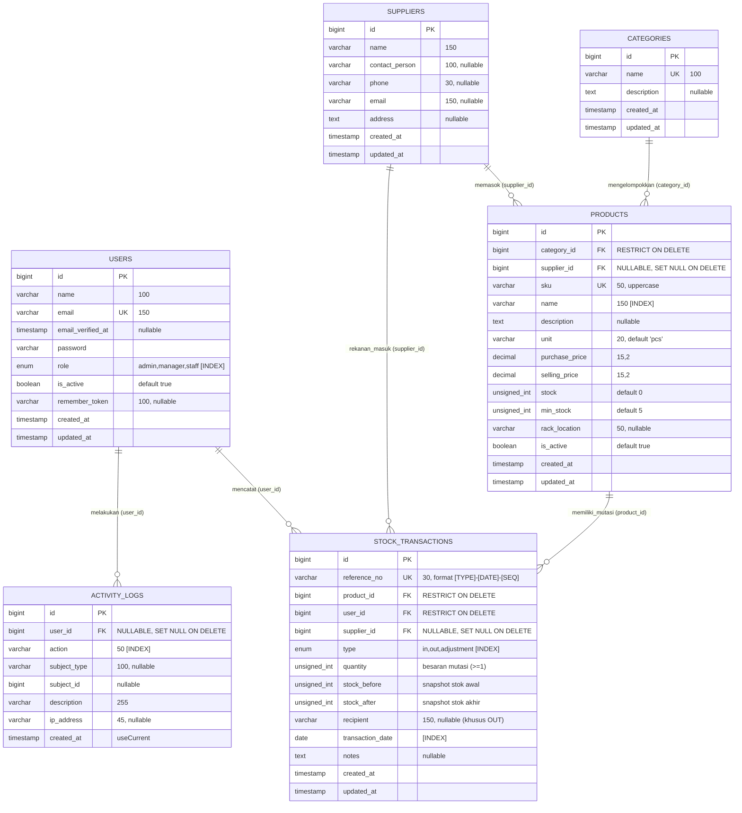

# Entity Relationship Diagram (ERD) - GudangKu

Dokumentasi rancangan skema database relasional **GudangKu** (Sistem Manajemen Inventaris Gudang). Database dirancang mengikuti aturan normalisasi (3NF), integritas referensial ketat (*foreign keys* dengan aturan *restrict* dan *set null*), serta pengindeksan performa untuk mendukung operasi transaksi dan pelaporan inventaris skala menengah.

---

## 1. Diagram Relasi Entitas (Mermaid ERD)

---

## 2. Penjelasan Relasi & Kardinalitas

| Entitas Asal | Kardinalitas | Entitas Tujuan | Deskripsi Relasi & Foreign Key Rule |
| :--- | :---: | :--- | :--- |
| **`categories`** | `1 : N` | **`products`** | Satu kategori dapat menaungi banyak produk. **Aturan Hapus (BR5)**: `RESTRICT ON DELETE`. Kategori tidak dapat dihapus selama masih memiliki produk terkait untuk menjaga konsistensi katalog. |
| **`suppliers`** | `1 : N` | **`products`** | Satu pemasok dapat menyuplai banyak produk. **Aturan Hapus (BR7)**: `SET NULL ON DELETE`. Jika data pemasok dihapus, relasi pada produk diubah menjadi `NULL` tanpa menghapus data produk tersebut. |
| **`products`** | `1 : N` | **`stock_transactions`** | Satu produk dapat memiliki banyak riwayat mutasi stok. **Aturan Hapus (BR6)**: `RESTRICT ON DELETE`. Produk yang sudah memiliki riwayat transaksi tidak dapat dihapus demi integritas buku besar stok (*immutable ledger*). |
| **`users`** | `1 : N` | **`stock_transactions`** | Satu pengguna (admin/manager/staff) mencatat banyak transaksi stok. **Aturan Hapus**: `RESTRICT ON DELETE`. Pengguna yang memiliki jejak transaksi tidak dapat dihapus langsung dari database. |
| **`suppliers`** | `1 : N` | **`stock_transactions`** | Satu pemasok dapat menjadi rekanan asal pada transaksi stok masuk (`in`). **Aturan Hapus (BR7)**: `SET NULL ON DELETE`. Menjaga histori buku besar tetap utuh meskipun pemasok dinonaktifkan/dihapus. |
| **`users`** | `1 : N` | **`activity_logs`** | Satu pengguna mencatat jejak audit aktivitas sistem. **Aturan Hapus**: `SET NULL ON DELETE`. Audit log tetap tersimpan meskipun akun pengguna terkait telah dihapus. |

---

## 3. Kamus Data & Spesifikasi Kolom

### 3.1. Tabel `users`
Menyimpan akun pengguna aplikasi beserta penetapan hak akses berbasis peran (*Role-Based Access Control*).

| Nama Kolom | Tipe Data | Atribut | Keterangan |
| :--- | :--- | :--- | :--- |
| `id` | `BIGINT UNSIGNED` | `PK`, `AUTO_INCREMENT` | Identifikator unik pengguna |
| `name` | `VARCHAR(100)` | `NOT NULL` | Nama lengkap pengguna |
| `email` | `VARCHAR(150)` | `NOT NULL`, `UNIQUE` | Alamat email (kredensial login) |
| `email_verified_at` | `TIMESTAMP` | `NULL` | Waktu verifikasi email (opsional) |
| `password` | `VARCHAR(255)` | `NOT NULL` | Hash sandi bcrypt (cost factor 12) |
| `role` | `ENUM('admin','manager','staff')` | `NOT NULL`, `INDEX`, `DEFAULT 'staff'` | Peran pengguna dalam otorisasi sistem (BR8) |
| `is_active` | `BOOLEAN` | `NOT NULL`, `DEFAULT 1` | Status akun aktif (1) atau dinonaktifkan (0) |
| `remember_token` | `VARCHAR(100)` | `NULL` | Token sesi remember-me |
| `created_at`, `updated_at` | `TIMESTAMP` | `NULL` | Timestamp pencatatan dan pembaruan |

### 3.2. Tabel `categories`
Kategori pengelompokan produk di gudang (mis. Elektronik, ATK, Perkakas).

| Nama Kolom | Tipe Data | Atribut | Keterangan |
| :--- | :--- | :--- | :--- |
| `id` | `BIGINT UNSIGNED` | `PK`, `AUTO_INCREMENT` | Identifikator unik kategori |
| `name` | `VARCHAR(100)` | `NOT NULL`, `UNIQUE` | Nama kategori produk |
| `description` | `TEXT` | `NULL` | Deskripsi atau cakupan kategori |
| `created_at`, `updated_at` | `TIMESTAMP` | `NULL` | Timestamp pencatatan dan pembaruan |

### 3.3. Tabel `suppliers`
Data pemasok atau vendor penyedia barang ke gudang.

| Nama Kolom | Tipe Data | Atribut | Keterangan |
| :--- | :--- | :--- | :--- |
| `id` | `BIGINT UNSIGNED` | `PK`, `AUTO_INCREMENT` | Identifikator unik pemasok |
| `name` | `VARCHAR(150)` | `NOT NULL` | Nama perusahaan / entitas vendor |
| `contact_person` | `VARCHAR(100)` | `NULL` | Nama kontak penanggung jawab |
| `phone` | `VARCHAR(30)` | `NULL` | Nomor telepon / WhatsApp aktif |
| `email` | `VARCHAR(150)` | `NULL` | Alamat email korespondensi |
| `address` | `TEXT` | `NULL` | Alamat kantor / gudang supplier |
| `created_at`, `updated_at` | `TIMESTAMP` | `NULL` | Timestamp pencatatan dan pembaruan |

### 3.4. Tabel `products`
Master data barang yang disimpan dan dikelola di gudang.

| Nama Kolom | Tipe Data | Atribut | Keterangan |
| :--- | :--- | :--- | :--- |
| `id` | `BIGINT UNSIGNED` | `PK`, `AUTO_INCREMENT` | Identifikator unik produk |
| `category_id` | `BIGINT UNSIGNED` | `FK`, `NOT NULL` | Relasi ke `categories.id` (`RESTRICT`) |
| `supplier_id` | `BIGINT UNSIGNED` | `FK`, `NULL` | Relasi ke `suppliers.id` (`SET NULL`) |
| `sku` | `VARCHAR(50)` | `NOT NULL`, `UNIQUE` | Stock Keeping Unit unik (BR4) |
| `name` | `VARCHAR(150)` | `NOT NULL`, `INDEX` | Nama item produk barang |
| `description` | `TEXT` | `NULL` | Spesifikasi dan rincian teknis barang |
| `unit` | `VARCHAR(20)` | `NOT NULL`, `DEFAULT 'pcs'` | Satuan barang (pcs, box, rim, botol, dll.) |
| `purchase_price` | `DECIMAL(15,2)` | `NOT NULL`, `DEFAULT 0` | Harga beli / modal (HPP) |
| `selling_price` | `DECIMAL(15,2)` | `NOT NULL`, `DEFAULT 0` | Harga jual (Validasi: >= purchase_price, BR10) |
| `stock` | `INT UNSIGNED` | `NOT NULL`, `DEFAULT 0` | Kuantitas stok fisik terkini (BR1, BR2) |
| `min_stock` | `INT UNSIGNED` | `NOT NULL`, `DEFAULT 5` | Ambang batas peringatan stok menipis (BR11) |
| `rack_location` | `VARCHAR(50)` | `NULL` | Kode penempatan fisik rak (mis. `RAK-A1`) |
| `is_active` | `BOOLEAN` | `NOT NULL`, `DEFAULT 1` | Status ketersediaan katalog produk |
| `created_at`, `updated_at` | `TIMESTAMP` | `NULL` | Timestamp pencatatan dan pembaruan |

### 3.5. Tabel `stock_transactions`
Buku besar mutasi stok barang (*immutable ledger*). Data pada tabel ini tidak boleh diubah atau dihapus setelah dicatat.

| Nama Kolom | Tipe Data | Atribut | Keterangan |
| :--- | :--- | :--- | :--- |
| `id` | `BIGINT UNSIGNED` | `PK`, `AUTO_INCREMENT` | Identifikator unik transaksi |
| `reference_no` | `VARCHAR(30)` | `NOT NULL`, `UNIQUE` | Nomor referensi unik format `[TYPE]-[YYYYMMDD]-[SEQ]` (BR12) |
| `product_id` | `BIGINT UNSIGNED` | `FK`, `NOT NULL` | Relasi ke `products.id` (`RESTRICT`) |
| `user_id` | `BIGINT UNSIGNED` | `FK`, `NOT NULL` | Relasi ke `users.id` operator pencatat (`RESTRICT`) |
| `supplier_id` | `BIGINT UNSIGNED` | `FK`, `NULL` | Pemasok rekanan (khusus tipe `in`) (`SET NULL`) |
| `type` | `ENUM('in','out','adjustment')` | `NOT NULL`, `INDEX` | Tipe mutasi stok |
| `quantity` | `INT UNSIGNED` | `NOT NULL` | Kuantitas perubahan stok (selalu positif) |
| `stock_before` | `INT UNSIGNED` | `NOT NULL` | Posisi stok sesaat sebelum mutasi |
| `stock_after` | `INT UNSIGNED` | `NOT NULL` | Posisi stok tepat setelah mutasi |
| `recipient` | `VARCHAR(150)` | `NULL` | Pihak / divisi penerima barang (khusus tipe `out`) |
| `transaction_date` | `DATE` | `NOT NULL`, `INDEX` | Tanggal efektif mutasi stok fisik |
| `notes` | `TEXT` | `NULL` | Alasan atau referensi dokumen pengiriman |
| `created_at`, `updated_at` | `TIMESTAMP` | `NULL` | Timestamp pencatatan sistem |

> **Catatan Pengindeksan Gabungan (*Composite Index*)**:
> Dibuat indeks gabungan `INDEX (product_id, transaction_date)` untuk mempercepat agregasi kartu stok dan pelaporan filter rentang waktu.

### 3.6. Tabel `activity_logs`
Tabel jejak audit (*audit trail*) untuk kepatuhan keamanan dan transparansi operasional.

| Nama Kolom | Tipe Data | Atribut | Keterangan |
| :--- | :--- | :--- | :--- |
| `id` | `BIGINT UNSIGNED` | `PK`, `AUTO_INCREMENT` | Identifikator unik log |
| `user_id` | `BIGINT UNSIGNED` | `FK`, `NULL` | Pelaku aksi (`SET NULL ON DELETE`) |
| `action` | `VARCHAR(50)` | `NOT NULL`, `INDEX` | Kode aksi (mis. `login`, `stock_in`, `create_product`) |
| `subject_type` | `VARCHAR(100)` | `NULL` | Namespace Model target (polymorphic ref) |
| `subject_id` | `BIGINT UNSIGNED` | `NULL` | ID data target |
| `description` | `VARCHAR(255)` | `NOT NULL` | Narasi deskripsi aktivitas dalam bahasa Indonesia |
| `ip_address` | `VARCHAR(45)` | `NULL` | Alamat IPv4 / IPv6 klien saat melakukan aksi |
| `created_at` | `TIMESTAMP` | `NOT NULL`, `DEFAULT CURRENT_TIMESTAMP` | Waktu pencatatan aksi |

---

## 4. Tabel Sistem Bawaan Framework (Laravel)

Selain 6 tabel domain bisnis di atas, skema basis data menyertakan tabel pendukung framework untuk menjamin keandalan *session state* dan antrean:
- **`sessions`**: Menyimpan data sesi login pengguna berbasis MySQL (`SESSION_DRIVER=database`). Mendukung pencatatan IP, User Agent, *payload* sesi terenkripsi, dan invalidasi otomatis saat logout atau perubahan kata sandi.
- **`password_reset_tokens`**: Menyimpan token pengaturan ulang kata sandi dengan pengikatan alamat email dan masa kedaluwarsa.
- **`cache` & `cache_locks`**: Menyimpan cache data agregat dan penguncian atomik sistem.
- **`jobs`, `job_batches`, `failed_jobs`**: Infrastruktur penanganan antrean tugas asinkronus (*queue worker*).
